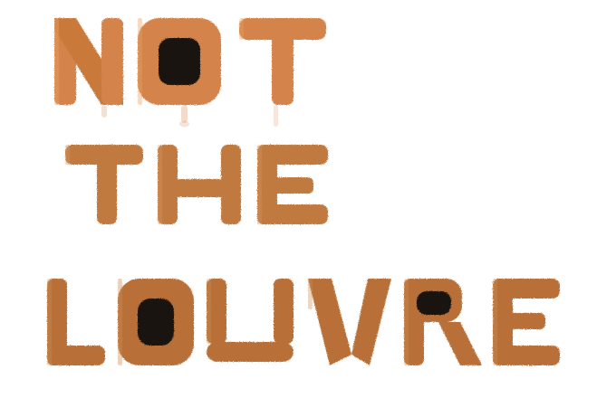

<p align="center">
  
</p>


*[Leer en Español 🇪🇸](./README.es.md)*

> "A very expensive frame for a very questionable drawing."

Welcome to the classiest art institution on the internet, where the presentation says "national treasure" and the actual piece says "cat drawn in 40 seconds with a trackpad."

**Not The Louvre** is a community art party game built for the [Midudev Cubepath 2026 Hackathon](https://github.com/midudev/hackaton-cubepath-2026). You draw something, publish it, fork other people's work, and let the crowd decide whether you've made a masterpiece or a public embarrassment.

---

## 🧐 So what is it, really?

It's a museum sim for people whose artistic peak was doodling in MS Paint.

You open the app, sketch something mildly unhinged, hit publish, and wait for the public to either crown you the next genius or pelt your work with a perfectly justified tomato.

## ✨ Why it looks cool (Features & Tech)

- 🖌️ **A dazzling drawing tool**: You get a brush and a few colors. That's it. No layers, no shapes, no bucket fill. If your vision depends on advanced tooling, perhaps your vision was weak.
- 🍴 **Forking**: See a piece that's almost perfect? Fork it, keep the original as a locked background, and add the moustache it was clearly missing. The full ancestry stays visible so credit and blame are preserved.
- 🎩 **3D Navigation meets 2D Canvas (Threlte)**: We used Threlte so that navigating the app's routes feels like organically interacting with a 3D model of the studio. But when it's time to draw, we use the classic 2D Canvas API for maximum fluidity.
- 🍅 **Realtime Social Loop**: Votes and comments update live without refreshing the page, thanks to Supabase Realtime.
- 🧠 **Lossless JSON Drawing Documents**: To allow infinite forking without cumulative image degradation, the source of truth isn't a PNG. We store a versioned, compressed JSON document of brush strokes. When you fork, you clone the math, not the pixels.
- 🛡️ **Moderation & The inevitable "TTP" Metric**: In any public multiplayer drawing app, the *Time To Penis (TTP)* inevitably trends to zero. To manage this, we built a real moderation system from day one: creators can label work as NSFW (hidden behind an 18+ filter), and admins have quick shortcuts to censor unacceptable chaos.
- 📦 **Reproducible & Self-Hostable Infrastructure**

## 📦 Repository layout

The repository now uses a small Bun workspace so the root stays focused on shared docs and infra.

```text
.
├── apps/
│   └── web/        # SvelteKit app
├── devenv.nix      # Linux-first devenv shell, tasks, and processes
├── devenv.yaml     # Pinned devenv inputs
├── docs/           # Product and project docs
├── compose.yaml    # Local Supabase stack
├── .env.supabase.example
└── package.json    # Workspace scripts
```

- Run the local Supabase stack with `bun run db:start` and stop it with `bun run db:stop`.
- The first `bun run db:start` copies `.env.supabase.example` to `.env.supabase` if you have not customized it yet.
- `bun run db:start` boots only the services the app talks to (`db`, `kong`, `rest`, `storage`, `imgproxy`, `realtime`). Supabase Studio, GoTrue, postgres-meta, logflare and the edge runtime are behind the `tools` profile: `docker compose --env-file .env.supabase --profile tools up -d`.
- Run the app from the repository root with `bun run dev`, `bun run check`, `bun run build`, etc.
- App-specific configuration now lives in `apps/web`.
- Environment files for the app now live in `apps/web/.env` and `apps/web/.env.example`.

## `devenv` workflow

This repo now includes a Linux-first `devenv` setup for local development. The direct Bun and Docker Compose workflow still works, but `devenv` is the preferred DX entrypoint.

Prerequisites:

- install `devenv`
- keep Docker Engine running on the host; `devenv` provides the client tooling, not the daemon

Typical flow from the repository root:

- `devenv shell` to enter the managed shell
- inside `devenv shell`, run `ntl:format`, `ntl:check`, `ntl:test`, and the other `ntl:*` commands directly
- `devenv up` to start the local Supabase stack, run database migrations, and then launch the app
- `devenv tasks run ntl:check` to run the root typecheck pipeline
- `devenv tasks run ntl:test` to run the root test pipeline
- `devenv tasks run ntl:db-stop` to stop the local Supabase stack when you are done

Useful task mappings:

- `ntl:dev` -> `bun run dev`
- `ntl:format` -> `bun run format`
- `ntl:lint` -> `bun run lint`
- `ntl:check` -> `bun run check`
- `ntl:test` -> `bun run test`
- `ntl:db-start` -> `bun run db:start`
- `ntl:db-stop` -> `bun run db:stop`
- `ntl:db-reset` -> `bun run db:reset`
- `ntl:db-migrate` -> `bun run db:migrate`

Notes:

- `devenv up` runs `ntl:db-start`, then `ntl:db-migrate`, and only then starts the app process.
- leaving `devenv up` does not automatically stop the Docker Compose stack; stop it explicitly with `devenv tasks run ntl:db-stop` or `bun run db:stop`.
- `devenv` does not auto-generate `apps/web/.env`; app env files remain user-managed.

## Commit hooks

Commit messages follow the emoji + Conventional Commits convention documented in
`AGENTS.md`, and CI validates every commit message. Install the local hook once so a bad
message is caught before you push:

```sh
bun run hooks:install   # git config core.hooksPath .githooks
```

## Production deployment

Production is **Cloudflare Workers with static assets**, built with
`@sveltejs/adapter-cloudflare` (`apps/web/svelte.config.js`, `apps/web/wrangler.jsonc`). CI
builds and deploys on every push to `main` (`.github/workflows/deploy.yml`). The full
runbook — one-time Worker setup, Hyperdrive, CPU limits, local `wrangler dev` — lives in
[`docs/deploy-cloudflare-workers.md`](./docs/deploy-cloudflare-workers.md).

### Worker secrets

Production secrets never live in the repository. Set them once per Worker with
`wrangler secret put KEY`, run from `apps/web`:

- `ORIGIN=https://not-the-louvre.art`
- `DATABASE_URL=...`
- `BETTER_AUTH_SECRET=...`
- `SUPABASE_PUBLIC_URL=...`
- `SUPABASE_ANON_KEY=...` (without it the browser never gets a realtime client and live votes and comments stop arriving, silently)
- exactly one of `SUPABASE_SECRET_KEY=...` or `SERVICE_ROLE_KEY=...`
- `SUPABASE_JWT_SECRET=...`
- optional `ARTWORK_STORAGE_BUCKET=artworks`

The deploy workflow itself needs two repository secrets, ideally scoped to a `production`
environment: `CLOUDFLARE_API_TOKEN` and `CLOUDFLARE_ACCOUNT_ID`.

It also reads one repository **variable** (not a secret), `PRODUCTION_URL` — e.g.
`https://not-the-louvre.art`. The post-deploy smoke test uses it to check the custom domain
instead of the workers.dev URL wrangler reports, and fails the run when neither is
available: a deploy nobody verified is not a deploy that passed.

Values intentionally exposed to browser realtime clients today:

- `SUPABASE_PUBLIC_URL`
- `SUPABASE_ANON_KEY`

### Rollback

Every deploy publishes a new Worker version, so a rollback is a Cloudflare operation rather
than a server one:

```sh
cd apps/web
bunx wrangler deployments list   # find the previous version
bunx wrangler rollback           # or: bunx wrangler rollback <version-id>
```

If the regression is in the code rather than in the configuration, revert the commit on
`main`; the push redeploys automatically.

## 📜 The philosophy

The whole idea is to get people from "I opened the browser" to "I published a ridiculous drawing" in under two minutes. No long onboarding, no solemn creative process, no paywall pretending to be a feature. Just draw, laugh, judge, repeat.

---
*Built with ❤️ and a medically unnecessary amount of caffeine for Cubepath 2026.*
